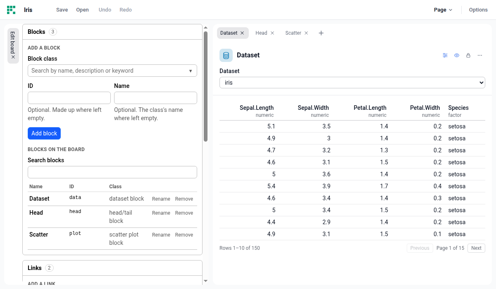
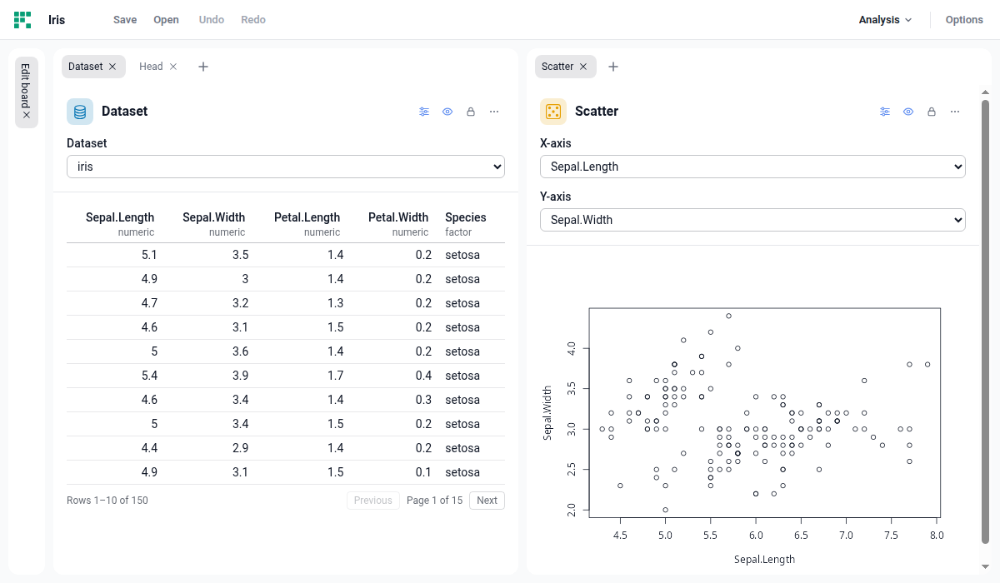

<!-- README.md is generated from README.Rmd. Please edit that file -->

# blockr.dock

<!-- badges: start -->

[](https://lifecycle.r-lib.org/articles/stages.html#experimental)
[](https://github.com/BristolMyersSquibb/blockr.dock/actions/workflows/ci.yaml)
[](https://app.codecov.io/gh/BristolMyersSquibb/blockr.dock)
[](https://CRAN.R-project.org/package=blockr.dock)
<!-- badges: end -->

This package gives
[blockr](https://github.com/BristolMyersSquibb/blockr) its dock, the
frontend that draws a board in the browser. A navbar runs across the top
of the page, and below it the dock shows the board in views, one at a
time. Each view is a grid of panels, drawn with
[dockview](https://dockview.dev), which hold the cards of the board’s
blocks and the UIs of its plugins. Wherever blockr.dock is available,
the `serve()` of blockr.core runs the dock as the app’s frontend.

## Installation

You can install the development version of blockr.dock from
[GitHub](https://github.com/) with:

``` r
# install.packages("pak")
pak::pak("BristolMyersSquibb/blockr.dock")
```

## A board in the dock

An app script builds its board with blockr.core, and serves it:

``` r
library(blockr.core)
library(blockr.dock)

blocks <- c(
  data = new_dataset_block("iris"),
  head = new_head_block(),
  plot = new_scatter_block(x = "Sepal.Length", y = "Sepal.Width")
)
links <- c(new_link("data", "head"), new_link("data", "plot"))

serve(new_board(blocks = blocks, links = links, name = "Iris"))
```

<figure>

<figcaption aria-hidden="true">A board in the dock</figcaption>
</figure>

The board holds no view, so the dock opens on a view of its own, “Page”.
Its left rail holds core’s Edit board plugin, which adds, renames and
removes blocks, links and stacks. Beside the rail, a tab group holds the
card of each block. The navbar holds the board’s name, Save and Open,
which core’s storage plugin gives, Undo and Redo, the views menu and the
options button.

## Views

The dock plugin, which `new_dock_plugin()` makes, gives the board its
views, each with a grid that places its panels:

``` r
board <- new_board(
  blocks = blocks,
  links = links,
  plugins = list(
    new_dock_plugin(
      views = list(
        analysis = dock_view(
          dock_grid(
            panels("data", "head"),
            "plot",
            rail(plg("edit"), collapsed = TRUE)
          ),
          name = "Analysis"
        ),
        data = dock_view("data")
      )
    ),
    edit = new_edit_board_plugin()
  ),
  name = "Iris"
)

serve(board)
```

<figure>

<figcaption aria-hidden="true">The view “Analysis”</figcaption>
</figure>

The view “Analysis” shows a tab group of the dataset and the head block
beside the plot, with core’s Edit board plugin on a collapsed rail. The
views menu in the navbar switches to the view “Data”. The vignette
“Views and grids”, `vignette("layouts", package = "blockr.dock")`, shows
how an app script writes views, folders and grids.

## The navbar

An app script gives the items of the navbar to `serve()` in `navbar`.
The function `custom_navbar()` starts from the default bar, as here,
where it adds a menu of links:

``` r
issues <- "https://github.com/BristolMyersSquibb/blockr/issues"

serve(
  board,
  navbar = custom_navbar(
    navbar_menu(
      "help",
      "Help",
      navbar_link("issues", "Report an issue", issues)
    )
  )
)
```

The help page `?default_navbar` lists the parts of the default bar and
every kind of item.

## A locked board

Under the board lock, which the blockr option `locked` sets, as
`options(blockr.locked = TRUE)` does, the blocks and links of the board
stay as they are (see `help("locked-board", package = "blockr.core")`).
The dock then draws no “+” in the header of a tab group and no close
button on a tab, and the navbar shows that the board is read-only. The
user still switches views, brings a tab to the front, and opens or
collapses a rail.

## Learn more

- The vignette “Views and grids”,
  `vignette("layouts", package = "blockr.dock")`, shows how an app
  script writes the dock’s views, folders and grids.
- The vignette “How a plugin uses the dock’s panels”,
  `vignette("plugins", package = "blockr.dock")`, is for the author of a
  package whose plugin class has a UI.
- The vignette “Migration notes for app scripts”,
  `vignette("migration-notes", package = "blockr.dock")`, lists what an
  app script of blockr.dock 0.2.0 changes to run on version 0.2.1.
